  

 

  

  

  
  
  
  
  
  

 

<!-- ========================================== -->
<!-- TERMINAL DISPLAY: ASCII ART + STATS CARD -->
<!-- ========================================== -->

<table border="0" cellpadding="0" cellspacing="0" width="100%">
  <tr>
    <td width="50%" valign="top">
      
    </td>
    <td width="50%" valign="top">
      
    </td>
  </tr>
</table>

 

<!-- ========================================== -->
<!-- LIVE CONTRIBUTION HEATMAP SVG (DAILY SYNC) -->
<!-- ========================================== -->

  

 

### 👨‍💻 About Me

- 🎓 **Education**: B.E. Computer Science & Engineering student with a passion for software design and system architecture.
- 💻 **Core Engineering**: Specialized in building responsive, high-performance web applications using **Next.js, React 18, TypeScript, Node.js, and modern CSS/Tailwind**.
- 🤖 **AI & Automation**: Building intelligent automation workflows and offline intelligence pipelines using **Python, Ollama (LLaMA-3), and data analytics**.
- 🎨 **Design & Motion**: Strong background in visual aesthetics, video editing (After Effects), and modern UI/UX principles—bridging technical logic with fluid design.
- 🔭 **Currently Building**: Next.js 15 enterprise billing systems and reproducible ML experimentation frameworks.
- 💬 **Ask Me About**: Full-Stack architecture, RESTful APIs, local LLM tooling, and frontend performance.

 
 

### 🛠️ Tech Stack & Tooling

  <b>Frontend & UI</b> 
  

  <b>Backend, Database & AI</b> 
  

  <b>Tools, Cloud & DevOps</b> 
  

 

### 🚀 Featured Projects

| Project | Tech Stack | Highlights | Links |
| :--- | :--- | :--- | :---: |
| **College Management System (CMS)** | `React 18` `TypeScript` `Node.js` `MySQL` | Comprehensive academic ERP with real-time attendance, assignment tracking, internal marks management, and circulars. | [🌐 Live Demo](https://college-management-system-cms-gamma.vercel.app) • [💻 Code](https://github.com/prasanthzodiac/College-Management-System-CMS-) |
| **Company Intelligence AI** | `Python` `Ollama (LLaMA-3)` `Web Scraping` | Infynd Hackathon project: an offline intelligence pipeline that ingests domain datasets, captures local web snapshots, and synthesizes structured corporate dossiers using local LLMs. | [🌐 Live Demo](https://company-intelligence-ai-infynd-hack.vercel.app) • [💻 Code](https://github.com/prasanthzodiac/Company-Intelligence-AI---Infynd-Hackathon) |
| **Smart Billing System** | `Next.js 15` `TypeScript` `Tailwind CSS` | Enterprise billing & invoice generation platform built with Next.js App Router, responsive styling, and modular component architecture. | [💻 Code](https://github.com/prasanthzodiac/Billing-system) |
| **Valorae** | `React` `Vite` `Tailwind CSS` | Exclusive digital collectibles platform and authenticated fan ownership experience with polished UI animations. | [🌐 Live Demo](https://valorae.vercel.app) • [💻 Code](https://github.com/prasanthzodiac/Valorae) |
| **Weave** | `TypeScript` `Vite` `CSS` | Interactive web experience and component showcase demonstrating clean frontend architecture and responsive styling. | [🌐 Live Demo](https://weave-bay.vercel.app) • [💻 Code](https://github.com/prasanthzodiac/Weave) |
| **Lumisyn** | `Python` `Pytest` `Machine Learning` | Experimental ML research codebase featuring reproducible evaluation runs, structured benchmarking, and test suites. | [💻 Code](https://github.com/prasanthzodiac/Lumisyn) |

 

---

  

  <i>⭐️ Built with passion by Prasanth Zodiac. Always open to collaborations and exciting opportunities!</i>

